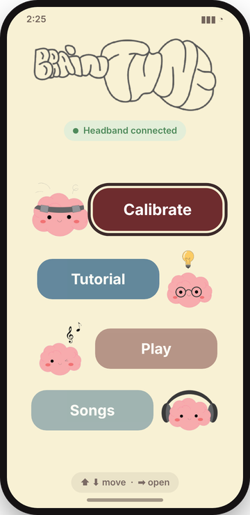
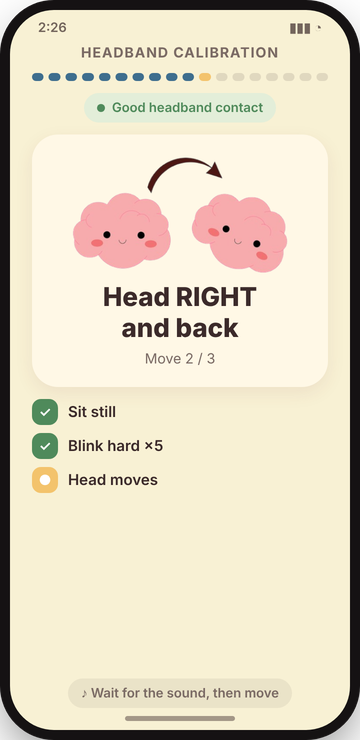
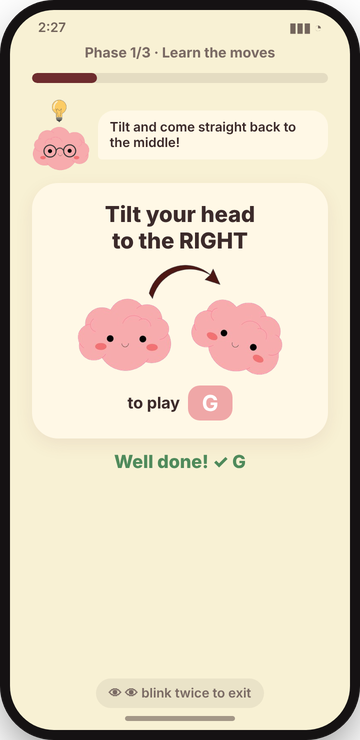
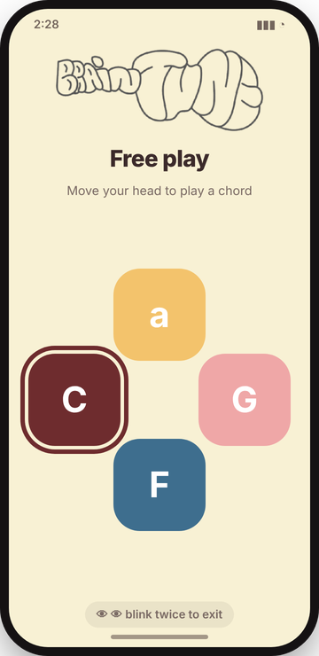
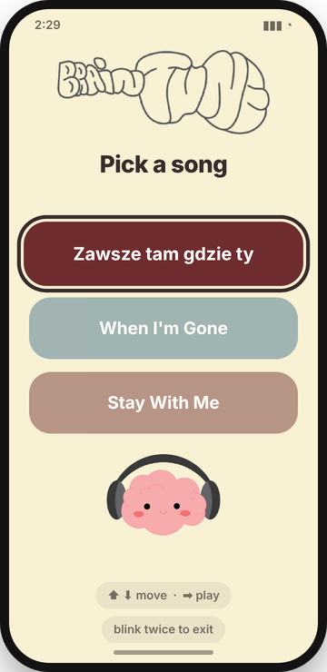
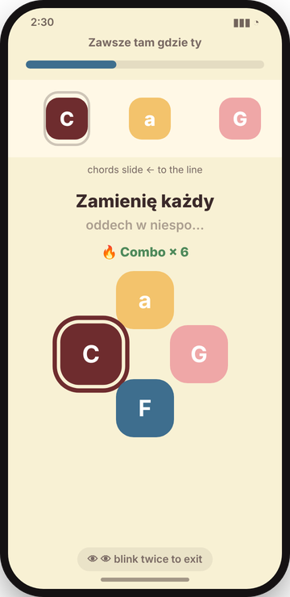

<div align="center">


### Music for every body.

Play guitar chords and real songs with your head – with or without your hands.

</div>

---

## About

**brainTUNE** is an Android app controlled by the **BrainAccess HALO** EEG headband. It was built at the **Heroes of the Brain** neurohackathon (PWr, *hands-free interaction* category).

Tilt your head and the app plays a chord. Blink and it performs an action. You can play along with real songs, with a backing track and lyrics.

It's for everyone: musicians who want a one-person band, singers, beginners and kids, friends jamming together. It also lets people who can't use their hands make music – after a stroke, with paralysis or with an injury.

## Controls

| Move | Action |
|---|---|
| ⬅️ head left | **C** |
| ➡️ head right | **G** |
| ⬆️ head up | **a** (A minor) |
| ⬇️ head down | **F** |
| 👁 strong blink | action |
| 👁👁 two blinks | back |

In menus: head up / down moves the selection, head right opens.

## Screens

<table>
<tr>
<td align="center"><br><b>Menu</b></td>
<td align="center"><br><b>Calibration</b></td>
<td align="center"><br><b>Tutorial</b></td>
</tr>
<tr>
<td align="center"><br><b>Free play</b></td>
<td align="center"><br><b>Songs</b></td>
<td align="center"><br><b>Play along</b></td>
</tr>
</table>

- **Calibration** – sit still, blink 5×, then do each head move 3×. The app learns your signal and saves it.
- **Tutorial** – learn the moves, recall the chords without hints, then play C–G–a–F.
- **Free play** – jam the four chords freely.
- **Play along** – chords slide to the line in sync with the song, lyrics change line by line, and a combo grows when you hit the right chord on time.

## How it works

```
HALO headband ──Bluetooth──▶ Python (laptop) ──UDP / Wi-Fi──▶ Android app (Kotlin)
```

- **Head moves:** the headband's accelerometer. Each person's moves are recorded during calibration and compared live (cosine similarity). In our tests on 3 people, 100% of head moves were recognised.
- **Blinks:** frontal EEG electrodes Fp1 + Fp2, filtered to 0.5–10 Hz. A blink must look the same on both electrodes, and blinks are ignored right after a head move.
- **App:** each command simply presses a button on the current screen, so everything also works by touch.

## Running it

1. Close BrainAccess Board, put on the headband and run:
   ```bash
   py comands_final.py
   ```
2. In `MainActivity.kt`, set the laptop address:
   - emulator: `"10.0.2.2"`. Also run `adb emu redir add udp:5005:5005`.
   - phone: the laptop's IPv4 address from `ipconfig` (phone and laptop on the same network, e.g. the phone's hotspot). Also set `PHONE_IP = None` in Python.
3. Press ▶ **Run** in Android Studio. When the menu shows **● Headband connected**, you're ready.

**Add a song:** put `name_m.mp3` and `name.lrc` in `res/raw`, with lines like `[00:20.00] C | lyrics`. Then add the song in `load_song()` in `SongPlayActivity.kt` and add a button in `activity_song.xml`.

## Team

**Maja Kilarska · Alicja Januszkiewicz · Natalia Domaradzka**

Illustrations by our team's graphic designer.
